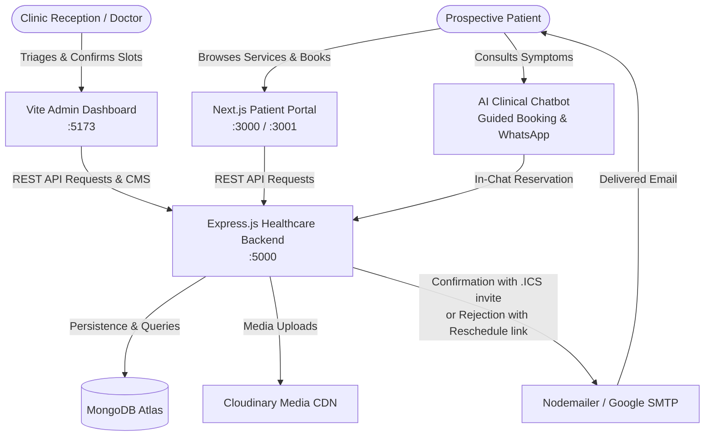
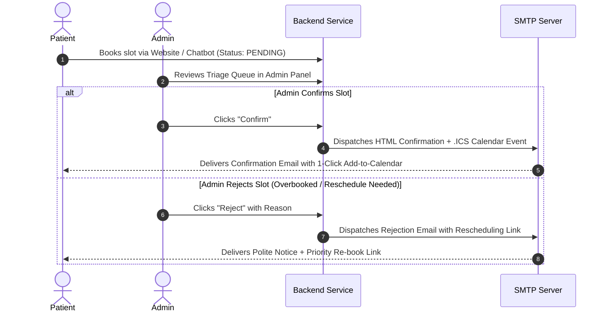

# 🏥 PRALASH Dermystique & Dentique

> **Advanced Multi-Specialty Clinic Platform** — Premium Patient Portal, AI-Powered Clinical Triage Chatbot, RESTful Healthcare API, and Real-Time Admin Operations Dashboard.

[](https://nextjs.org/)
[](https://react.dev/)
[](https://www.typescriptlang.org/)
[](https://tailwindcss.com/)
[](https://nodejs.org/)
[](https://expressjs.com/)
[](https://www.mongodb.com/)
[](https://vitejs.dev/)
[](https://cloudinary.com/)

---

## 📋 Table of Contents
1. [Ecosystem Architecture](#-ecosystem-architecture)
2. [Monorepo Structure](#-monorepo-structure)
3. [Key Features](#-key-features)
   - [Patient Web Portal (`/frontend`)](#1-patient-web-portal-frontend)
   - [Admin Operations Panel (`/adminPanel`)](#2-clinic-admin-operations-panel-adminpanel)
   - [Clinical REST API & Email Service (`/backend`)](#3-clinical-rest-api--services-backend)
4. [Tech Stack](#-tech-stack)
5. [Quick Start & Local Setup](#-quick-start--local-setup)
6. [Environment Variables](#-environment-variables)
7. [REST API Reference](#-rest-api-reference)
8. [Automated Email & Calendar Engine](#-automated-email--calendar-engine)
9. [Deployment Guide](#-deployment-guide)

---

## 🌐 Ecosystem Architecture

The platform connects prospective patients, clinical specialists, and medical triage staff through three synchronized services:



---

## 📁 Monorepo Structure

```text
Arquette-Digital/
├── frontend/                     # Next.js 16 Patient Portal
│   ├── src/
│   │   ├── app/                  # App Router (pages: /, /booking, /doctors, /services/*, /blog)
│   │   ├── components/
│   │   │   ├── clinic/           # Chatbot, BookingEngine, BeforeAfterSlider, DoctorCards
│   │   │   ├── common/           # Header, Footer, ConsultationCtaBanner
│   │   │   └── ui/               # Reusable UI primitives
│   │   ├── context/              # ThemeContext (live branding sync)
│   │   ├── data/                 # Clinical services data, doctor profiles, SEO schemas
│   │   └── lib/                  # ChatEngine (NLP triage logic & symptom routing)
│   └── package.json
│
├── backend/                      # Node.js + Express + MongoDB REST API
│   ├── src/
│   │   ├── config/               # MongoDB connection with DNS fallback
│   │   ├── controllers/          # Appointment, Doctor, Blog, Theme controllers
│   │   ├── models/               # Mongoose schemas (Appointment, Doctor, Blog, Theme)
│   │   ├── routes/               # Express REST route definitions
│   │   ├── services/             # Nodemailer service (HTML templates & .ICS calendar invites)
│   │   ├── seed.js               # Clinical data seeder
│   │   └── server.js             # Express application entrypoint
│   ├── .env                      # Database, Cloudinary & SMTP secrets
│   └── package.json
│
└── adminPanel/                   # Vite + React 19 Reception & Triage Dashboard
    ├── src/
    │   ├── components/
    │   │   ├── analytics/        # Clinical KPI charts & revenue overview
    │   │   ├── appointments/     # Live booking triage pipeline & status actions
    │   │   ├── doctors/          # Specialist roster & schedule editor
    │   │   ├── blogs/            # CMS blog writer with Cloudinary media upload
    │   │   ├── modals/           # Appointment detail modal & triage action center
    │   │   └── theme/            # Real-time brand color customizer
    │   ├── App.jsx               # Main operational state container
    │   └── main.jsx
    └── package.json
```

---

## ✨ Key Features

### 1. Patient Web Portal (`/frontend`)
* **Multi-Specialty Clinical Showcase:** High-impact landing pages for **Dental** (CAD/CAM implants, Digital Smile Design, Invisalign), **Dermatology/Skin** (Hydra-Facials, Laser Resurfacing, Chemical Peels), and **Hair Restoration** (Bio-Sapphire FUE, GFC & PRP Therapy).
* **Interactive Before & After Sliders:** Touch-enabled clinical image comparison sliders showcasing authentic patient transformations.
* **Smart Appointment Booking Engine:** Multi-step reservation flow with department selection, attending doctor picker, real-time date/slot validation, medical symptom intake, and unique reference codes (`PRL-XXXXXX`).
* **AI Clinical Chatbot (`HealthcareChatbot.tsx`):**
  * Automated medical symptom triage and department recommendation.
  * In-chat guided appointment reservation flow without leaving the conversation.
  * 1-tap WhatsApp clinical hand-off with pre-filled consultation summaries.
  * Voice input (Speech-to-Text) for effortless mobile inquiries.
* **SEO & Performance:** Fully static and dynamic SEO schemas, OpenGraph tags, JSON-LD medical clinic structured data, dynamic `sitemap.ts`, and `robots.ts`.
* **Responsive Modern Aesthetic:** Built with Tailwind CSS v4, custom HSL clinical palettes, frosted glassmorphism, and responsive navigation drawers for phones and tablets.

### 2. Clinic Admin Operations Panel (`/adminPanel`)
* **Patient Triage Queue:** Real-time categorization of bookings into **Pending Triage**, **Confirmed**, **Completed**, and **Cancelled**.
* **1-Click Workflow Actions:**
  * **Confirm Booking:** Instantly marks appointment confirmed and dispatches a branded HTML email with an attached `.ics` iCalendar calendar invite.
  * **Reject / Cancel Slot:** Prompts for custom or preset cancellation reasons (e.g., *Doctor on Duty Emergency*, *Slot Overbooked*) and sends a polite notice with an instant 1-click rescheduling link.
  * **Manual Email Resend:** Resend confirmation or cancellation notices on-demand if a patient needs an updated copy.
* **Specialist Doctor Management:** Add and modify doctor bios, consultation fees, experience years, department specialties, and upload high-resolution headshots to Cloudinary.
* **Medical Blog CMS:** Draft and publish patient education articles with rich markdown formatting and Cloudinary cover image integration.
* **Analytics & Business Intelligence:** Live dashboard metrics including monthly consultation counts, department demand breakdown, booking conversion rates, and estimated clinical revenue.
* **Live Theme Customizer:** Toggle clinic brand themes (e.g., Clinical Emerald, Sapphire Blue, Modern Slate) synchronized live with the patient portal.

### 3. Clinical REST API & Services (`/backend`)
* **Enterprise Email Service (`emailService.js`):** Responsive HTML email templates designed for 100% rendering fidelity across Gmail, Apple Mail, and Outlook. Automatically generates standard iCalendar (`.ics`) attachments for Google Calendar and Apple Calendar.
* **Resilient Infrastructure:** Automated DNS server fallback (`8.8.8.8`, `1.1.1.1`) to guarantee MongoDB Atlas SRV query resolution under restrictive ISP/Windows environments.
* **Cloudinary Media Storage:** Cloud-hosted, optimized image uploads with automatic compression and CDN delivery.
* **Audit & Tracking:** Tracks email delivery state, message IDs, failure diagnostics, and admin notes directly on each appointment record.

---

## 🛠 Tech Stack

| Domain | Technology | Description |
| :--- | :--- | :--- |
| **Frontend** | Next.js 16.4.1 (Turbopack) | React 19 Server & Client Components, App Router |
| **Styling** | Tailwind CSS v4 | Cutting-edge CSS styling, dynamic HSL color variables |
| **Icons** | Lucide React | Modern medical & navigation iconography |
| **Admin Dashboard** | Vite 8 + React 19 | High-speed SPA with Tailwind CSS v4 |
| **Backend API** | Node.js (ESM) + Express 4.x | RESTful microservice architecture |
| **Database** | MongoDB Atlas + Mongoose 8.x | Scalable document store with schema validation |
| **File Storage** | Cloudinary + Multer | Cloud-based media management for doctors and blog covers |
| **Email & Calendar** | Nodemailer | Responsive HTML email rendering + `.ics` calendar generation |

---

## 🚀 Quick Start & Local Setup

### Prerequisites
* **Node.js:** `v20.0.0` or higher
* **npm:** `v10.0.0` or higher
* **MongoDB:** A free [MongoDB Atlas](https://www.mongodb.com/atlas) cluster connection string or local MongoDB instance

---

### Step 1: Clone the Repository
```bash
git clone https://github.com/sachin9272/Arquette-Digital.git
cd Arquette-Digital
```

---

### Step 2: Configure Environment Variables

Create a `.env` file in the `backend/` directory:

```env
# backend/.env
PORT=5000
NODE_ENV=development
FRONTEND_URL=http://localhost:3000
ADMIN_URL=http://localhost:5173

# Database Connection
MONGO_URI=mongodb+srv://<username>:<password>@cluster.mongodb.net/pralash-clinic?retryWrites=true&w=majority

# Nodemailer / Gmail SMTP Configuration
SMPT_MAIL=care@pralash.com
SMPT_PASSWORD=your-16-character-app-password

# Cloudinary Media Storage (Optional for photo uploads)
CLOUDINARY_CLOUD_NAME=your_cloud_name
CLOUDINARY_API_KEY=your_api_key
CLOUDINARY_API_SECRET=your_api_secret
```

*(Optional)* Create a `.env.local` in `frontend/`:
```env
# frontend/.env.local
NEXT_PUBLIC_API_URL=http://localhost:5000/api
```

---

### Step 3: Install Dependencies

Open separate terminal windows for each service or install sequentially:

```bash
# 1. Install Backend
cd backend
npm install

# 2. Install Frontend
cd ../frontend
npm install

# 3. Install Admin Panel
cd ../adminPanel
npm install
```

---

### Step 4: Seed Initial Clinical Data (Optional)
Populate the database with sample specialist doctors, sample appointments, and patient blog posts:
```bash
cd backend
npm run seed
```

---

### Step 5: Launch the Development Servers

Run each service in its own terminal:

```bash
# Terminal 1: Backend API (runs on http://localhost:5000)
cd backend
npm run dev

# Terminal 2: Frontend Patient Portal (runs on http://localhost:3000 or :3001)
cd frontend
npm run dev

# Terminal 3: Admin Operations Panel (runs on http://localhost:5173)
cd adminPanel
npm run dev
```

| Service | Local URL | Purpose |
| :--- | :--- | :--- |
| **Patient Portal** | `http://localhost:3000` | Public website, booking flow, AI chatbot |
| **Admin Panel** | `http://localhost:5173` | Triage dashboard, appointment confirm/reject, doctor roster |
| **Backend API** | `http://localhost:5000` | REST API, email dispatch, health checks |

---

## 📡 REST API Reference

All API routes are prefixed with `/api`.

### Appointments (`/api/appointments`)
| Method | Endpoint | Description |
| :--- | :--- | :--- |
| `GET` | `/` | List appointments with pagination, status filter, department filter, and search |
| `POST` | `/` | Create a new patient appointment booking (Status defaults to `pending`) |
| `GET` | `/:id` | Get single appointment by MongoDB ID or booking reference (`PRL-XXXXXX`) |
| `PUT` | `/:id` | Update appointment details, notes, or reschedule date/time |
| `PATCH` | `/:id/status` | Update status (`pending`, `confirmed`, `completed`, `cancelled`). Triggers confirmation/rejection email dispatch |
| `POST` | `/:id/send-confirmation`| Manually resend booking confirmation email with `.ics` invite |
| `POST` | `/:id/send-rejection` | Manually resend cancellation/rejection email with reason |
| `GET` | `/stats/overview` | Retrieve KPI analytics (total bookings, department split, monthly count) |
| `DELETE`| `/:id` | Delete an appointment record |

### Doctors (`/api/doctors`)
| Method | Endpoint | Description |
| :--- | :--- | :--- |
| `GET` | `/` | Retrieve all active medical specialists |
| `POST` | `/` | Add a new specialist (Supports multipart image upload to Cloudinary) |
| `PUT` | `/:id` | Update doctor credentials, consultation fee, or availability |
| `DELETE`| `/:id` | Archive or delete a doctor profile |

### Theme & Branding (`/api/theme`)
| Method | Endpoint | Description |
| :--- | :--- | :--- |
| `GET` | `/` | Fetch active clinic brand theme and palette settings |
| `PUT` | `/` | Update clinic branding theme (updates patient portal live) |

### Blogs & Patient Education (`/api/blogs`)
| Method | Endpoint | Description |
| :--- | :--- | :--- |
| `GET` | `/` | Retrieve published healthcare articles |
| `POST` | `/` | Publish new blog post (Supports multipart cover photo upload) |
| `DELETE`| `/:id` | Remove blog post |

---

## 📬 Automated Email & Calendar Engine

The platform features an automated communication workflow:



### Key Technical Safeguards:
1. **Gmail Image Detachment Fix:** Inlined `vertical-align: middle` and table-based action buttons to prevent Gmail's emoji image parser from breaking alignment.
2. **Standard `.ics` Calendar Invites:** Generates standard iCalendar v2.0 MIME attachments (`METHOD:REQUEST`) with clinical reminders 2 hours prior to visit.
3. **Graceful Credential Handling:** Automatic whitespace trimming and quote-stripping for 16-character Google App Passwords.

---

## 🚢 Deployment Guide

### Deploying the Frontend (Vercel)
1. Push your repository to GitHub.
2. In the [Vercel Dashboard](https://vercel.com/), click **Add New Project** and select `Arquette-Digital`.
3. Set the **Root Directory** to `frontend`.
4. Add environment variables:
   * `NEXT_PUBLIC_API_URL` = `https://your-backend.onrender.com/api`
5. Click **Deploy**.

### Deploying the Admin Panel (Vercel / Netlify)
1. In Vercel or Netlify, select the repository.
2. Set the **Root Directory** to `adminPanel`.
3. Set Build Command: `npm run build` and Output Directory: `dist`.
4. Configure `VITE_API_BASE` pointing to your deployed backend.

### Deploying the Backend (Render / Railway / VPS)
1. In [Render](https://render.com/), create a new **Web Service**.
2. Connect your repo and set the **Root Directory** to `backend`.
3. Build Command: `npm install`
4. Start Command: `npm start`
5. Add your `.env` production variables (`MONGO_URI`, `SMPT_MAIL`, `SMPT_PASSWORD`, `FRONTEND_URL`, `ADMIN_URL`).

---

## 📄 License & Credits

* **Clinic Brand:** PRALASH Dermystique & Dentique
* **Location:** Block 1, 708, 3rd Cross Rd, HRBR Layout 1st Block, Kalyan Nagar, Bengaluru, Karnataka 560043
* **Helpline:** `+91 99005 17699` | **Email:** `care@pralash.com`
* **License:** Proprietary — All Rights Reserved. Built for PRALASH Multi-Specialty Clinic.
